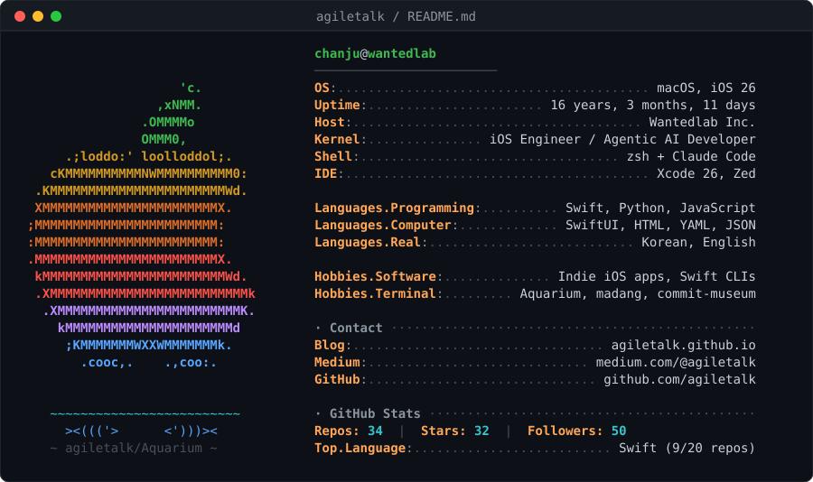

  

# chanju Jeon · 전찬주

iOS engineer at [Wanted](https://www.wanted.co.kr), building better hiring experiences.
I ship apps by day and terminal toys by night. 🐠

낮에는 원티드에서 iOS 앱을 만들고, 밤에는 터미널 장난감을 만듭니다.

**Now:** Agentic dev workflows with Claude Code · Swift CLI tools · macOS apps

## Projects

- 🐠 **[Aquarium](https://github.com/agiletalk/Aquarium)** — a tiny healing aquarium in your terminal. Fish with names, jellyfish, rare whale visits, and chiptune BGM.
   터미널 속 힐링 ASCII 어항 — `brew install agiletalk/tap/aquarium`
- 🚢 **[relnote](https://github.com/agiletalk/relnote)** — release notes, curated for humans. Turns your git log into user-facing notes via Claude Code or Apple's on-device model — no API keys.
   커밋 로그를 사용자용 릴리즈 노트로 큐레이션하는 LLM CLI — `brew install agiletalk/tap/relnote`
- 🏛️ **[commit-museum](https://github.com/agiletalk/commit-museum)** — your git history, exhibited. A terminal museum for git log.
   내 커밋 기록을 전시하는 터미널 박물관 — `brew install agiletalk/tap/commit-museum`
- 🧭 **[ai-native-starter](https://github.com/agiletalk/ai-native-starter)** — a project template for 3–5 person teams working with AI agents. One source of truth, ADRs as HTML.
   AI와 함께 일하는 소수 팀을 위한 프로젝트 템플릿 — 진실은 한 군데에만
- 🎨 **[agile-xcode-themes](https://github.com/agiletalk/agile-xcode-themes)** — light & dark Xcode themes inspired by GitHub, Quiet Light, and Sundell colors.
   매일 보는 에디터니까, 눈이 편한 Xcode 테마

### Earlier

- 📝 [SwiftUINote](https://github.com/agiletalk/SwiftUINote) — a simple note app from SwiftUI's very first summer (2019). · SwiftUI가 나온 첫 해에 만든 노트 앱
- 📚 [BookkBookk](https://github.com/agiletalk/BookkBookk) — a book finder app, SwiftUI + TCA example. · SwiftUI + TCA 구조를 실험한 책 검색 앱

## Elsewhere

✍️ [Blog](https://agiletalk.github.io) · 📄 [Resume](https://github.com/agiletalk/resume)
